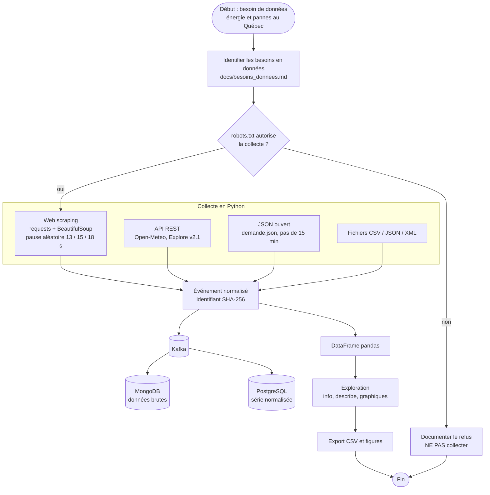

# Workflow du processus de collecte (énoncé, point 3)

**Notation :** organigramme (*flowchart*) en Mermaid, avec les symboles de la notation
BPMN simplifiée : ovale = début / fin, rectangle = tâche, losange = décision,
cylindre = stockage, cadre = sous-processus.

## Lecture

1. **Besoin** : le domaine est l'énergie et les pannes au Québec (voir `besoins_donnees.md`).
2. **Politique du site** : `robots.txt` est lu avant toute requête. 200 : les règles sont
   appliquées ; 401 ou 403 : tout est refusé ; autre 4xx : tout est permis ; 5xx ou réseau
   en panne : refus par prudence.
3. **Collecte** : quatre familles de sources, toutes derrière la même classe abstraite
   `BaseCollecteur` (méthode `extraire()`).
4. **Normalisation** : chaque enregistrement devient un `EvenementEnergie` ; son `event_id`
   SHA-256 permet d'ignorer les doublons à chaque relance.
5. **Représentation** : DataFrame pandas, exploration, puis export CSV et figures.

Les deux scripts d'entrée correspondent à ce schéma :
`mod_main.py` (pipeline complet avec Kafka et bases) et `tp_collecte_hydroquebec.py`
(script numéroté section par section, comme l'énoncé).
